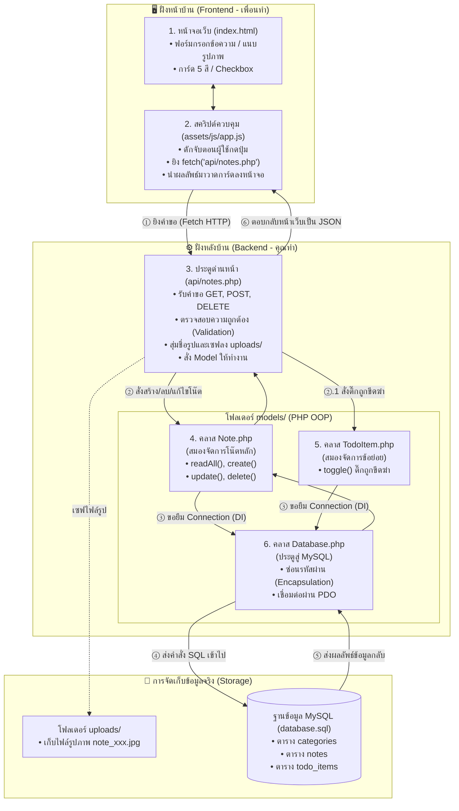
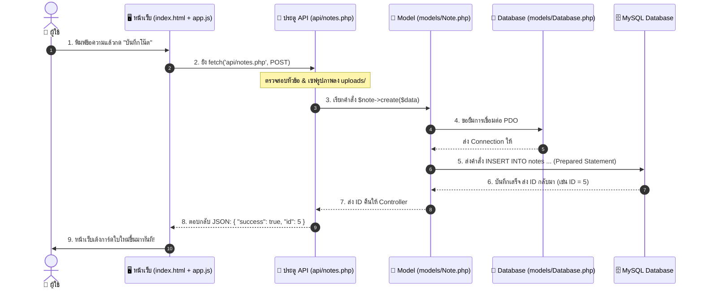

# 🎓 คู่มือเตรียมความพร้อมขึ้นสนามจริง (Backend & OOP Defense Guide)

คู่มือนี้สรุปเนื้อหาที่ตรงกับความเป็นจริง 100% ครอบคลุมทั้ง **บทบาทของไฟล์, การเดินทางของข้อมูล, หลักการ OOP, การคุมงาน AI, และ 4 จุดตายที่ต้องระวังในห้องสอบ**

---

## 🎙️ 1. โพยพูดนำเสนอฉบับความจริง (พูดตามนี้ ~ 2 นาที)

> *"สวัสดีครับอาจารย์ ในส่วนของโปรเจกต์นี้ ผมรับผิดชอบส่วนของ **Backend** ทั้งหมดครับ*
>
> **1. การวางแผนและสั่งงาน AI (OOAD Planning):**  
> *ผมเริ่มต้นจากการวาง Requirement ร่วมกับเพื่อน และปรึกษา AI เพื่อออกแบบสถาปัตยกรรมแบบ **Decoupled MVC** โดยผมสั่งให้ทำ `database.sql` (3 ตาราง) และ `README.md` ก่อน เพื่อเป็นข้อตกลงข้อมูล (Data Contract) ทำให้เพื่อนทำหน้าบ้านรอได้ และผมทำหลังบ้านคู่ขนานกันได้โดยไม่ตีกัน*
>
> **2. สถาปัตยกรรม OOP และไฟล์ที่ผมรับผิดชอบ:**  
> *หลังบ้านของเราแบ่งเป็น 3 คลาสหลัก:*  
> * `models/Database.php`: จัดการต่อ MySQL ซ่อนรหัสผ่านเป็น `private` (**Encapsulation**)  
> * `models/Note.php`: จัดการโน๊ตหลัก รับการเชื่อมต่อผ่าน Constructor (**Dependency Injection**)  
> * `models/TodoItem.php`: จัดการรายการย่อยที่ติ๊กถูกตามหลัก **Single Responsibility**  
> * `api/notes.php`: ทำหน้าที่เป็น Controller รับคำขอจากหน้าเว็บ แล้วส่งข้อมูลกลับเป็น **JSON**
>
> **3. การตรวจสอบบั๊กและควบคุม AI (Human Audit):**  
> *ตอนที่นำหน้าบ้านของเพื่อนมารวมกับหลังบ้าน พบปัญหาตัวแปรไม่ตรงกัน (Data Contract Mismatch) เช่น หน้าบ้านส่ง `todo_items` แต่หลังบ้านรอรับ `items` ผมจึงทำหน้าที่ **Audit โค้ด** และสั่งให้ AI ปรับแก้หลังบ้านให้ยืดหยุ่น และเพิ่มฟังก์ชัน `update()` จนระบบสามารถบันทึก ติ๊กถูกขีดฆ่า และลบข้อมูลลง MySQL ได้จริงสมบูรณ์ 100% ครับ"*

---

## 📁 2. แผนผังไฟล์: ไฟล์ไหนทำหน้าที่อะไร?

```text
ProjectOOP/
│
├── database.sql           <-- [พิมพ์เขียวฐานข้อมูล] ตาราง categories, notes, todo_items
│
├── models/                <-- [สมองคำนวณและคุยกับ DB ตามหลัก OOP]
│   ├── Database.php       <-- คลาสเปิดประตูเชื่อมต่อ MySQL ผ่าน PDO เพียงจุดเดียว
│   ├── Note.php           <-- คลาสจัดการโน๊ตหลัก (CRUD, ค้นหา, กรองหมวด, แจ้งเตือน)
│   └── TodoItem.php       <-- คลาสจัดการรายการย่อย (ติ๊กถูกขีดฆ่า, เพิ่ม/ลบข้อย่อย)
│
├── api/                   <-- [เคาน์เตอร์รับเรื่อง / Controller]
│   ├── notes.php          <-- รับคำสั่ง GET, POST, DELETE จากหน้าเว็บ แล้วตอบกลับเป็น JSON
│   └── todo_items.php     <-- จุดรับคำสั่งจัดการข้อย่อยโดยเฉพาะ
│
└── uploads/               <-- โฟลเดอร์จัดเก็บไฟล์รูปภาพที่ผู้ใช้อัปโหลด
```

---

## 🔄 3. การเดินทางของข้อมูล (Visual Data Flow & Sequence Diagram)

### 🗺️ แผนผังการไหลของข้อมูล (Architecture Flow)


### ⏱️ ลำดับเวลาการทำงาน 1-2-3-4-5-6 (Sequence Diagram)


### สถานการณ์ตัวอย่าง: "เมื่อผู้ใช้กดบันทึกโน๊ตใหม่" (อธิบายปากเปล่า)
1. **หน้าเว็บ (`index.html` + `app.js`):** รวบรวมข้อความ รูปภาพ และสีการ์ด แล้วยิงคำสั่ง `fetch('api/notes.php')` แบบ `POST`
2. **ตัวรับเรื่อง (`api/notes.php`):** 
   * เช็คความถูกต้อง (Validation) เช่น ต้องมีหัวข้อ (`title`)
   * หากมีรูปภาพ จะใช้ `uniqid()` เปลี่ยนชื่อไฟล์ใหม่แล้วย้ายไปเก็บที่โฟลเดอร์ `uploads/`
   * เรียกใช้งาน Model: `$note->create($data)`
3. **ตัวจัดการโน๊ต (`models/Note.php`):** 
   * ยืม Connection จาก `Database.php`
   * ใช้คำสั่ง SQL `INSERT INTO notes` ผ่าน Prepared Statement (`bindValue`) เพื่อความปลอดภัย
   * ถ้ามีรายการ To-Do จะวนลูปบันทึกลงตาราง `todo_items` ต่อทันที
4. **ตอบกลับหน้าเว็บ:** ส่งผลลัพธ์เป็น JSON `{"success": true, "id": 5}` กลับไป เพื่อให้หน้าเว็บรีเฟรชการ์ดขึ้นมาแสดงผลทันที

---

## 🧩 4. หลักการ OOP ที่ซ่อนอยู่ในโค้ด (เปิดชี้ให้อาจารย์ดูได้)

| หลักการ OOP | อยู่ที่ไฟล์ไหน? | ชี้โค้ดบรรทัดไหนให้อาจารย์ดู? | คำอธิบายสั้นๆ |
| :--- | :--- | :--- | :--- |
| **Encapsulation** | `models/Database.php` | ตัวแปร `$host`, `$password`, `$conn` เป็น `private` | ซ่อนตัวแปรสำคัญไม่ให้คลาสภายนอกเข้ามาแก้ไขโดยตรง ป้องกันข้อผิดพลาด |
| **Dependency Injection** | `models/Note.php` | ฟังก์ชัน `__construct($db)` | รับ Object `$db` เข้ามาจากภายนอก ทำให้ทุกคลาสแชร์ Connection เดียวกัน ประหยัด Memory |
| **Single Responsibility** | `models/TodoItem.php` | ทั้งคลาส `TodoItem` | แยกตรรกะการติ๊กถูกข้อย่อยออกมาเป็นคลาสต่างหาก ไม่เอาไปยัดรวมใน `Note` ให้โค้ดรก |
| **Separation of Concerns** | `api/notes.php` | ไฟล์ API ทั้งหมด | แยกหน้าที่ Controller (รับคำสั่ง) ออกจาก Model (คุยกับ DB) ใน API ไม่มีคำสั่ง SQL เลย |

---

## ⚠️ 5. สี่จุดตายที่ต้องระวังในห้องสอบ (พร้อมวิธีเอาตัวรอด)

### จุดตายที่ 1: Live Demo พังหน้างาน (สำคัญที่สุด!)
* **วิธีป้องกันก่อนเริ่มพรีเซนต์:**
  1. เปิด **XAMPP Control Panel** แล้วเช็คว่าปุ่ม **Apache** และ **MySQL** เป็นสีเขียว (Start แล้ว)
  2. เปิดแท็บเว็บรันรอไว้: `http://localhost/ProjectOOP`
  3. เปิดแท็บ **phpMyAdmin** รอไว้ที่ตาราง `notes` เพื่อกดรีเฟรชโชว์ว่าพอกดปุ่มบนเว็บ ข้อมูลเข้า Database จริงทันที

### จุดตายที่ 2: ถ้าเกิด Error หน้าเว็บนิ่ง จะดูยังไง?
* **คำตอบ:** กดปุ่ม **`F12`** บนคีย์บอร์ด $\rightarrow$ ไปที่แท็บ **Console** หรือ **Network** เพื่อดูว่าไฟล์ `api/notes.php` ตอบกลับมาเป็นสีแดง (Status 400 หรือ 500) หรือไม่ ช่วยให้รู้ทันทีว่าพังที่ข้อมูลตัวไหน

### จุดตายที่ 3: อาจารย์จับผิดว่า "ไหน Inheritance (การสืบทอด / `extends`)?"
* **ความจริง:** ในโค้ดเราใช้คลาส `Note` ดูแลทั้ง Text และ To-Do โดยไม่มีคำสั่ง `extends`
* **คำตอบเอาตัวรอด:** *"เราออกแบบตามหลัก **KISS (Keep It Simple, Stupid)** และ **YAGNI** ครับอาจารย์ เพื่อไม่ให้โครงสร้างคลาสซับซ้อนเกินความจำเป็นสำหรับโปรเจกต์ 2 สัปดาห์ แต่คลาสแม่ `Note` ถูกออกแบบให้พร้อมแตกเป็น Subclass `TextNote` และ `TodoNote` ในอนาคตได้ทันทีครับ"*

### จุดตายที่ 4: ชี้เส้นแบ่งงานกับเพื่อนให้ขาด
* **คำตอบ:** *"เส้นแบ่งงานอยู่ที่ **REST API** ครับ ฝั่งหน้าบ้าน (HTML, CSS, JS) เพื่อนทำ 100% ส่วนฝั่งหลังบ้าน (การออกแบบ Database, คลาส PHP OOP ใน `models/` และตัวรับส่งข้อมูลใน `api/`) ผมรับผิดชอบทั้งหมดครับ"*

---

## 🛡️ 6. คลังคำถาม-คำตอบยอดฮิตของอาจารย์

* **Q: ทำไมเลือกใช้ PDO แทน mysqli?**
  * **A:** *"PDO เป็นมาตรฐาน OOP สากลของ PHP รองรับ Prepared Statements ป้องกัน SQL Injection ได้ 100% และถ้าอนาคตเปลี่ยนฐานข้อมูลไปใช้ PostgreSQL ก็ไม่ต้องรื้อโค้ดใหม่ครับ"*
* **Q: ทำไมเวลาลบโน๊ตแม่ ข้อย่อย To-Do ถึงหายไปด้วย?**
  * **A:** *"เพราะใน `database.sql` เรากำหนด Foreign Key เป็น `ON DELETE CASCADE` ไว้ครับ เมื่อโน๊ตแม่ถูกลบ MySQL จะลบข้อมูลลูกตามอัตโนมัติ ป้องกันข้อมูลขยะตกค้าง"*
* **Q: ป้องกันปัญหาอัปโหลดรูปชื่อซ้ำยังไง?**
  * **A:** *"เราใช้ฟังก์ชัน `uniqid('note_', true)` เพื่อสุ่มชื่อไฟล์ตามเวลาระดับไมโครวินาที ทำให้ไฟล์ไม่ทับกันแน่นอนครับ"*
