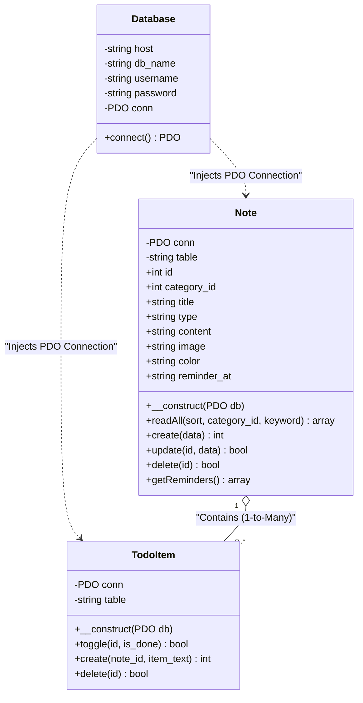

# 🎓 คู่มือเตรียมตัวพรีเซนต์โปรเจกต์ (Backend & OOP Defense Guide)

คู่มือนี้จัดทำขึ้นเป็นพิเศษเพื่อให้คุณสามารถ**อธิบายสถาปัตยกรรมหลังบ้าน ตอบคำถามอาจารย์ได้อย่างมั่นใจ และเข้าใจโค้ดทุกส่วนอย่างถ่องแท้**

---

## 🎙️ 1. สคริปต์พูดนำเสนอภาพรวม (พูดตามนี้ได้เลย ~2 นาที)

> *"สวัสดีครับอาจารย์ ในส่วนของ **Backend** ผมรับผิดชอบการออกแบบสถาปัตยกรรมและฐานข้อมูลทั้งหมดครับ*
> 
> *ระบบของเราพัฒนาด้วย **PHP เชิงวัตถุ (OOP)** ทำงานร่วมกับฐานข้อมูล **MySQL** โดยใช้สถาปัตยกรรมแบบ **Decoupled MVC (Model-View-Controller)** ครับ*
> 
> * ฝั่ง **View** คือหน้าเว็บที่เพื่อนผมพัฒนาด้วย HTML, CSS และ JavaScript
> * ฝั่ง **Controller** คือโฟลเดอร์ `api/` ทำหน้าที่เป็น REST API คอยรับคำขอ และส่งข้อมูลกลับเป็น JSON
> * ฝั่ง **Model** คือโฟลเดอร์ `models/` ซึ่งเป็นหัวใจหลักของ OOP ในโปรเจกต์นี้ มีคลาสจัดการข้อมูลที่ชัดเจนตามหลัก Single Responsibility
> 
> *จุดเด่นของหลังบ้านเราคือ โค้ดฝั่ง Controller จะไม่มีคำสั่ง SQL ปะปนอยู่เลยครับ เพราะเราผลักภาระงานคำนวณและฐานข้อมูลไปให้ Model ทั้งหมดตามหลัก Separation of Concerns ครับ"*

---

## 📊 2. แผนภาพคลาส (UML Class Diagram)

นำภาพไดอะแกรมนี้ไปใส่ในสไลด์พรีเซนต์ได้ทันที:

---

## 🧩 3. เจาะลึก 3 คลาสหลัก (หัวใจของคะแนน OOP)

### 📌 คลาสที่ 1: `Database.php`
* **หน้าที่:** รับผิดชอบเรื่องการเปิดการเชื่อมต่อฐานข้อมูล MySQL เพียงอย่างเดียว
* **หลักการ OOP ที่ใช้:**
  1. **Encapsulation (การห่อหุ้ม):** ตัวแปร credential เช่น `$host`, `$db_name`, `$username`, `$password` ถูกประกาศเป็น `private` เพื่อไม่ให้คลาสภายนอกเข้าถึงหรือแก้ไขค่าได้โดยตรง
  2. **PDO (PHP Data Objects):** เลือกใช้ `new PDO(...)` แทน `mysqli` เพราะเป็นมาตรฐาน OOP สากล และรองรับระบบ Prepared Statements ในตัว
  3. **Exception Handling:** ใช้ `try ... catch (PDOException $e)` เพื่อดักจับข้อผิดพลาดอย่างปลอดภัยเมื่อฐานข้อมูลมีปัญหา

### 📌 คลาสที่ 2: `Note.php`
* **หน้าที่:** Model หลัก จัดการข้อมูลโน๊ตทุกประเภท (บันทึกข้อความ และ สิ่งที่ต้องทำ)
* **หลักการ OOP ที่ใช้:**
  1. **Dependency Injection (DI):** ใน `__construct($db)` เราส่ง Object การเชื่อมต่อเข้ามาจากภายนอก แทนที่จะสร้าง `new Database()` ข้างในคลาส เพื่อประหยัด Memory และใช้ Connection ร่วมกัน
  2. **Dynamic Query Builder:** ฟังก์ชัน `readAll()` สามารถรับค่าเงื่อนไขมาต่อคำสั่ง SQL ได้อย่างยืดหยุ่น ทั้งค้นหาข้อความ (`LIKE`), กรองหมวดหมู่ (`category_id`), และจัดเรียงลำดับ (`ORDER BY`)
  3. **Data Aggregation:** หากโน๊ตใบนั้นเป็นชนิด `todo` โค้ดจะดึงรายการย่อยจากตาราง `todo_items` มารวมไว้ในการ์ดใบเดียวกันทันที เพื่อให้ Frontend นำไปวนลูปแสดงผลได้ง่าย

### 📌 คลาสที่ 3: `TodoItem.php`
* **หน้าที่:** จัดการรายการย่อยของสิ่งที่ต้องทำโดยเฉพาะ (ติ๊กถูกขีดฆ่า, เพิ่มข้อ, ลบข้อ)
* **หลักการ OOP ที่ใช้:**
  1. **Single Responsibility Principle (SRP):** เราแยกคลาสนี้ออกมาจาก `Note` เพราะข้อย่อยมีความสัมพันธ์แบบ **1-to-Many (โน๊ต 1 ใบ มีได้หลายข้อย่อย)** หากนำโค้ดไปยัดรวมใน `Note` จะทำให้คลาสมีหน้าที่เยอะเกินไปและแก้ยาก
  2. **Atomic Action:** เมธอด `toggle($id, $is_done)` ถูกออกแบบมาให้อัปเดตสถานะการทำงานได้อย่างรวดเร็ว โดยไม่ต้องส่งข้อมูลโน๊ตแม่ทั้งก้อนมาใหม่

---

## 🚪 4. ตัวกลาง Controller (`api/notes.php`)

* **หน้าที่:** ทำหน้าที่เป็น Controller ตามแบบจำลอง MVC
* **ลำดับการทำงาน (Data Flow):**
  1. หน้าบ้านกดปุ่ม (เช่น บันทึกโน๊ต) -> JavaScript ยิง `fetch('api/notes.php')`
  2. Controller ตรวจสอบว่าเป็น Method อะไร (`GET`, `POST`, `DELETE`)
  3. Controller ดึงข้อมูลจาก `$_POST` หรือ `json_decode(php://input)` มาตรวจสอบความถูกต้อง (Validation)
  4. Controller เรียกใช้งาน Model ที่เกี่ยวข้อง (เช่น `$note->create($data)`)
  5. Controller ตอบกลับหน้าบ้านเป็นรหัสสถานะ (HTTP Status Code) พร้อมข้อมูลแบบ **JSON**

---

## 🛡️ 5. คลังคำถาม-คำตอบปราบเซียน (อาจารย์ชอบถาม!)

#### Q1: ทำไมถึงเลือกใช้ PDO แทนที่จะใช้ฟังก์ชัน mysqli ปกติ?
> **ตอบ:** *"เพราะ PDO เป็นการเขียนเชิงวัตถุ (OOP) แท้ๆ มีระบบ Prepared Statement ป้องกัน SQL Injection ได้อย่างแน่นหนา และยังสามารถเปลี่ยนระบบฐานข้อมูลในอนาคต (เช่น ไป PostgreSQL หรือ SQLite) ได้โดยไม่ต้องรื้อโค้ดใหม่ครับ"*

#### Q2: ทำไมเวลาลบโน๊ตแม่ แล้วรายการข้อย่อย To-Do ถึงถูกลบตามไปด้วย? โค้ด PHP มีคำสั่งลบไหม?
> **ตอบ:** *"ในโค้ด PHP เราสั่งลบแค่ตาราง `notes` ครับ แต่รายการย่อยใน `todo_items` หายไปด้วยเพราะตอนออกแบบ Database เราสร้าง Foreign Key กำหนดเงื่อนไข `ON DELETE CASCADE` ไว้ ทำให้ MySQL จัดการลบข้อมูลลูกให้อัตโนมัติ ป้องกันข้อมูลขยะตกค้างครับ"*

#### Q3: ระบบป้องกันปัญหาชื่อไฟล์รูปซ้ำกันตอนอัปโหลดยังไง?
> **ตอบ:** *"เราใช้ฟังก์ชัน `uniqid('note_', true)` เพื่อสุ่มสร้างชื่อไฟล์ที่ไม่ซ้ำกันในระดับมิลลิวินาที ทำให้แม้ผู้ใช้จะอัปโหลดรูปชื่อเดียวกันพร้อมกัน ไฟล์จะไม่ทับกันแน่นอนครับ"*

#### Q4: ถ้าอาจารย์ถามว่า ตรงไหนคือ Encapsulation ในโค้ดของคุณ?
> **ตอบ:** *"อยู่ในคลาส `Database.php` ครับ ที่เราตั้งค่าตัวแปรเชื่อมต่อเป็น `private` รวมถึงในคลาส `Note` และ `TodoItem` ที่ตัวแปร `$conn` และ `$table` เป็น `private` คลาสภายนอกไม่สามารถเข้าถึงได้โดยตรง ต้องเรียกผ่าน Method ที่เราอนุญาตเท่านั้นครับ"*

#### Q5: ทำไมระบบถึงทำงานได้เร็ว หน้าเว็บไม่กระตุกเวลากดติ๊กถูก To-Do?
> **ตอบ:** *"เพราะหน้าบ้านส่งคำขอเฉพาะ ID ของข้อที่ถูกติ๊กมาที่ `api/notes.php?action=toggle_todo` และหลังบ้านก็สั่งอัปเดตเฉพาะบรรทัดนั้นในตาราง `todo_items` ทันที โดยไม่ต้องโหลดหรือประมวลผลโน๊ตทั้งระบบใหม่ครับ"*
